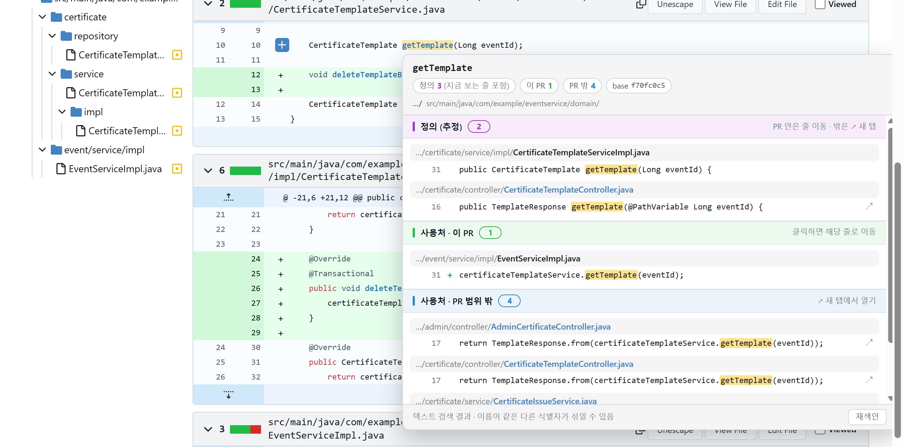
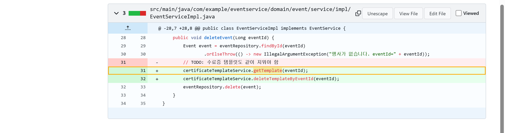
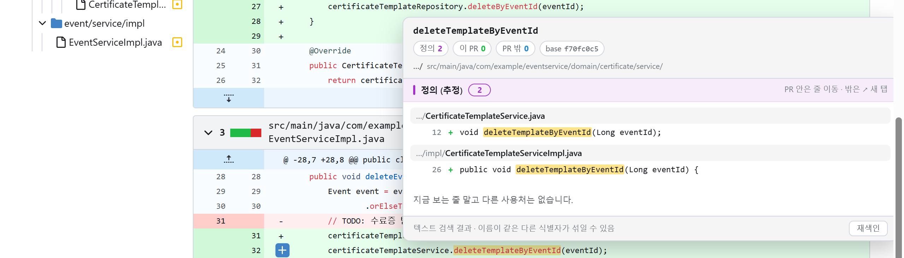
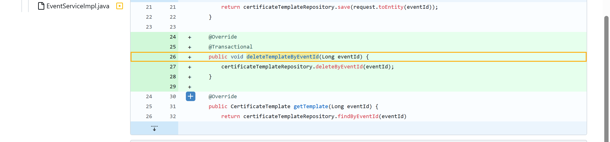
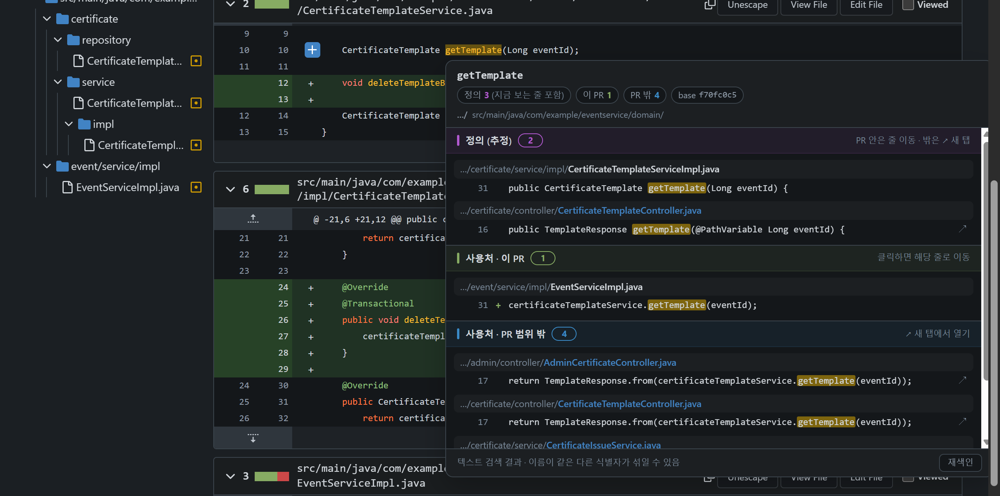
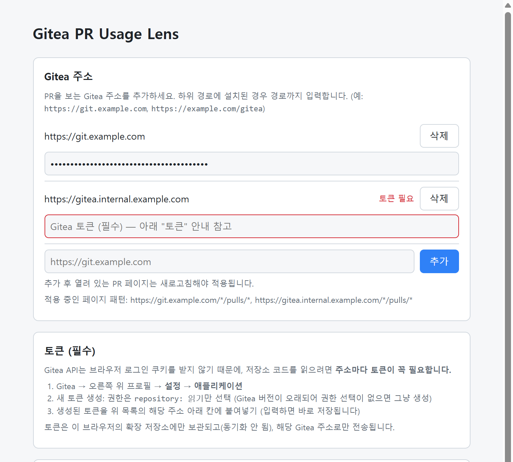
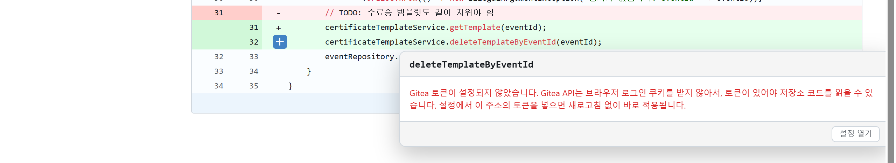

# Gitea PR Usage Lens

> 리뷰하다가 **"이 메서드, 대체 어디서 쓰길래 바뀐 거지?"** 싶을 때.
> 마우스만 올리세요.

Gitea PR의 **Files changed** 화면에서 식별자에 마우스를 올리면, 그 식별자의 **정의**와 **사용처**를 **이 PR 안 / PR 밖**으로 나눠서 바로 보여주는 크롬 확장입니다.
클래스가 여러 파일로 나뉘어 있어도 탭을 오가며 검색할 필요가 없습니다. Gitea 서버 설정은 하나도 바꾸지 않습니다.

---

## 이런 게 됩니다

### 마우스만 올리면, 정의와 사용처가 한 번에

인터페이스 선언, 구현체, 호출부를 한 화면에서 봅니다. 결과는 세 갈래로 나뉩니다.

| | 무엇을 보여주나 | 클릭하면 |
|---|---|---|
| 🟣 **정의 (추정)** | 메서드·클래스·필드가 선언된 곳 | PR 안이면 그 줄로 이동, 밖이면 새 탭 |
| 🟢 **사용처 · 이 PR** | 이 PR이 바꾸거나 보여주는 줄 중에서 쓰이는 곳 | diff 화면의 그 줄로 바로 이동 |
| 🔵 **사용처 · PR 범위 밖** | 이 PR이 건드리지 않은 파일에서 쓰이는 곳 | base 커밋의 그 줄을 새 탭으로 |

diff 화면 안에서 같은 단어는 노란색으로 함께 표시되고, 긴 패키지 경로는 공통 부분을 `…/`로 줄여서 파일 이름이 잘 보이게 합니다.

### PR 안의 사용처는 클릭 한 번으로 그 줄까지

"이 PR" 목록을 누르면 새 탭을 열지 않고 지금 보던 diff에서 해당 줄로 이동하고, 도착한 줄을 테두리로 잠깐 표시합니다. 추가(`+`)·삭제(`-`)된 줄도 구분해서 보여줍니다.

### "이 메서드, 안에서는 뭘 하지?" 구현도 바로

반대 방향도 됩니다. 호출하는 줄에서 메서드 이름에 마우스를 올리면, **정의 (추정)** 에 인터페이스 선언과 구현체가 함께 나옵니다.

구현체를 누르면 그 메서드 본문으로 바로 이동합니다. 서비스 → 구현체 → 리포지토리처럼 계층이 나뉜 코드에서, 파일을 찾아 다니지 않고 "실제로 무슨 일을 하는지"를 그 자리에서 확인할 수 있습니다.

구현체가 이 PR에서 바뀌지 않은 파일에 있으면 `↗`로 base 커밋의 구현 파일이 새 탭에서 해당 줄로 열립니다.

### 다크 테마도 그대로

Gitea의 테마 색을 그대로 따라가서, 라이트·다크 어느 쪽에서도 자연스럽게 보입니다.

### 처음 한 번만 받고, 그다음은 바뀐 파일만

- 처음 쓸 때 base 브랜치 소스를 압축 파일로 **한 번** 받아 브라우저에 저장합니다.
- 이후에는 base 브랜치가 바뀐 만큼만, **바뀐 파일만** 다시 받습니다. 같은 커밋이면 네트워크 요청이 아예 없습니다.
- 그래서 PR을 열 때마다 저장소 전체를 다시 받지 않습니다.

### 사내 Gitea에 그대로 붙여 쓰기

- **서버 설정·관리자 권한이 필요 없습니다.** 개인 읽기 전용 토큰 하나면 됩니다.
- **외부로 아무것도 보내지 않습니다.** 요청은 설정한 Gitea 주소로만 가고, 외부 서버·분석 도구·CDN을 쓰지 않습니다.
- 토큰은 이 브라우저의 확장 저장소에만 보관됩니다. (크롬 동기화로 올라가지 않습니다)

---

## 사용 방법

### 1. 설치

1. 크롬에서 `chrome://extensions`를 엽니다.
2. 오른쪽 위 **개발자 모드**를 켭니다.
3. **압축해제된 확장 프로그램을 로드합니다**를 누르고 이 폴더(`gitea-pr-usage-lens`)를 선택합니다.
4. 설치되면 설정 페이지가 자동으로 열립니다. 나중에는 툴바의 확장 아이콘을 눌러 열 수 있습니다.

### 2. Gitea 주소 추가

1. 설정 페이지의 **Gitea 주소** 칸에 사내 Gitea 주소를 넣고 **추가**를 누릅니다.
   - 예: `https://git.example.com`
   - Gitea가 하위 경로에 설치돼 있으면 경로까지: `https://example.com/gitea`
2. 크롬이 사이트 접근 권한을 물으면 **허용**합니다. 확장은 추가한 주소의 PR 페이지에서만 동작합니다.

### 3. 토큰 넣기 (필수)

Gitea API는 브라우저 로그인 쿠키를 받지 않기 때문에, 저장소 코드를 읽으려면 **토큰이 꼭 필요합니다.**

1. Gitea → 오른쪽 위 프로필 → **설정** → **애플리케이션**
2. **새 토큰 생성**: 이름은 자유롭게(예: `pr-usage-lens`), 권한은 **`repository: 읽기`만** 선택합니다.
   - Gitea 버전이 오래되어 권한을 고르는 화면이 없으면 그냥 생성하면 됩니다.
3. 생성된 토큰을 복사해, 설정 페이지에서 해당 주소 아래 칸에 붙여넣습니다. 입력하면 바로 저장됩니다.

토큰을 넣지 않고 PR에서 마우스를 올리면 아래처럼 안내가 뜹니다. **설정 열기**를 눌러 토큰을 넣으면, 열려 있던 PR 페이지에 새로고침 없이 바로 적용됩니다.

### 4. PR에서 쓰기

1. Gitea에서 PR을 열고 **파일 변경(Files changed)** 탭으로 갑니다.
2. 궁금한 메서드·클래스·변수 이름 위에 마우스를 올립니다.
3. 처음 한 번은 "압축 파일 받는 중…"처럼 진행 상황이 잠깐 보인 뒤 결과가 나옵니다. 그다음부터는 바로 뜹니다.

| 조작 | 동작 |
|---|---|
| 단어 위에 마우스 | 잠시 후(기본 0.4초) 툴팁 표시 |
| 툴팁 안으로 마우스 이동 | 툴팁이 유지되어 스크롤·클릭 가능 |
| "이 PR" 항목 클릭 | diff의 해당 줄로 이동 |
| `↗` 항목·PR 밖 파일 이름 클릭 | base 커밋의 해당 위치를 새 탭으로 |
| `Esc` / 페이지 스크롤 | 툴팁 닫기 |
| **재색인** | 이 저장소의 캐시를 지우고 다시 받기 |

### 설정 항목

| 항목 | 기본값 | 설명 |
|---|---|---|
| 표시 방식 | 마우스만 올려도 표시 | 너무 자주 뜨면 **Alt 키를 누른 채 올렸을 때만 표시**로 바꾸세요 |
| 표시 지연 | 400ms | 마우스를 멈추고 툴팁이 뜰 때까지의 시간 |
| 확장자 | Java·Kotlin·TS·JS·Python·Go 등 | 이 확장자의 파일만 검색합니다 |
| 제외 폴더 | `node_modules`, `build`, `target` 등 | 이 폴더 안은 검색하지 않습니다 |
| 최대 파일 크기 | 512KB | 이보다 큰 파일은 건너뜁니다 |

---

## 문제 해결

**마우스를 올려도 아무 반응이 없어요**
1. PR의 **파일 변경** 탭인지 확인하세요. 대화 탭에서는 동작하지 않습니다.
2. 설정 페이지에서 주소가 추가돼 있고 "권한 없음" 경고가 없는지 확인하세요. 주소를 추가한 뒤에는 열려 있던 PR 페이지를 한 번 새로고침해야 합니다.
3. `F12` → Console에 `[PR Usage Lens] 활성화: …`가 보이면 확장은 정상적으로 붙은 상태입니다. 보이지 않으면 PR 페이지에서 툴바의 확장 아이콘을 한 번 눌러 보세요.

**"API 접근 실패 (401 / 403 / 404)"가 떠요**
토큰이 비었거나, 만료됐거나, `repository: 읽기` 권한이 없는 경우입니다. 설정 페이지에서 토큰을 다시 넣어 주세요.

**처음 한 번이 오래 걸려요**
저장소가 크면 첫 압축 파일 다운로드에 시간이 걸립니다. 이후에는 바뀐 파일만 받습니다. 더 줄이고 싶으면 설정에서 확장자나 제외 폴더를 조정하세요.

**엉뚱한 곳도 사용처로 나와요**
이름 기준 텍스트 검색이라, 이름이 같은 다른 메서드·변수도 함께 나옵니다. 정의 판별도 코드 모양을 보고 추정합니다. (예: 컨트롤러의 같은 이름 메서드도 "정의"로 보일 수 있습니다)

## 한계

- 이름 기준 텍스트 검색입니다. IDE처럼 타입을 따지지는 않습니다.
- 사용처는 **base 브랜치 기준**입니다. 이 PR에서 새로 추가된 사용처는 "이 PR" 목록으로 보여줍니다.
- 화면에 아직 그려지지 않은 diff(접힌 파일, "diff 불러오기")는 "이 PR" 목록에 나오지 않습니다.
- 저장소 소스 캐시가 이 브라우저의 IndexedDB(Gitea 사이트 저장소)에 남습니다. 지우려면 툴팁의 **재색인**을 누르거나 사이트 데이터를 삭제하세요.

## 라이선스

[MIT](LICENSE)

Gitea 1.22 호환만 확인했습니다.
